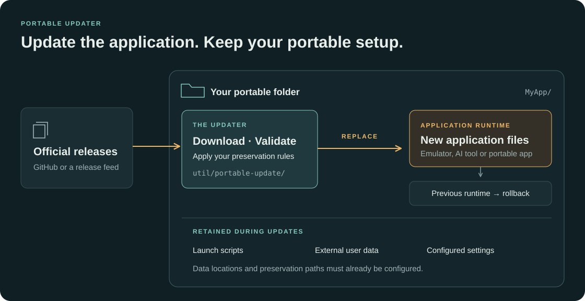

# Portable Updater

I built Portable Updater to maintain my collection of portable games, emulators and local AI tools. I wanted a consistent way to update application files without rearranging each folder or losing its settings and saves.

It's a Windows x64 command-line tool written in Go. JSON adapters describe where to download official packages and which files to preserve. The previous runtime is retained for rollback. The executable runs without an installed Go, Python, PowerShell or 7-Zip.

## Get started

1. Build with `build.cmd` ([Go requirements](docs/running.md#requirements)), or extract a Windows x64 ZIP from [Releases](https://github.com/keshon/portable-updater/releases).
2. Double-click `portable-update.exe`. Choose the application folder or executable, review what was detected, then press Enter to set up. Numbered settings on the review screen can be changed directly.
3. Close the application and double-click `updater-update.cmd` in its folder. The existing application launcher stays in place; `updater-rollback.cmd` restores the previous runtime after an update.

Setup checks the existing runtime and portable settings. It does not move application data, overwrite existing updater files or start an update. See [setup and configuration](docs/running.md#set-up-a-container) for the review steps, custom layouts and building from source.

## How it works

Each portable folder has its own updater and configuration. Application launchers are separate from the update and rollback commands. A console wizard handles first-time setup.

To update an installed copy of Portable Updater itself, run `portable-update.exe --self-update` from its `util/portable-update` folder. See [self-update](docs/running.md#update-portable-updater-itself) for scope and recovery.

## Included adapters

| Application | Adapter | Container example |
| --- | --- | --- |
| DuckStation | [duckstation-windows.json](adapters/duckstation-windows.json) | [duckstation.json](examples/duckstation.json) |
| llama.cpp (CUDA 13.4) | [llamacpp-windows.json](adapters/llamacpp-windows.json) | [llamacpp.json](examples/llamacpp.json) |
| KoboldCpp (CUDA) | [koboldcpp-windows.json](adapters/koboldcpp-windows.json) | [koboldcpp.json](examples/koboldcpp.json) |
| PCSX2 | [pcsx2-windows.json](adapters/pcsx2-windows.json) | [pcsx2.json](examples/pcsx2.json) |
| RPCS3 | [rpcs3-windows.json](adapters/rpcs3-windows.json) | [rpcs3.json](examples/rpcs3.json) |
| Cemu | [cemu-windows.json](adapters/cemu-windows.json) | [cemu.json](examples/cemu.json) |
| Xenia | [xenia-windows.json](adapters/xenia-windows.json) | [xenia.json](examples/xenia.json) |
| Dolphin | [dolphin-windows.json](adapters/dolphin-windows.json) | [dolphin.json](examples/dolphin.json) |
| shadPS4 | [shadps4-windows.json](adapters/shadps4-windows.json) | [shadps4.json](examples/shadps4.json) |
| DOSBox Pure Unleashed | [dosbox-pure-windows.json](adapters/dosbox-pure-windows.json) | [dosbox-pure.json](examples/dosbox-pure.json) |

The shadPS4 adapter updates the emulator core in the configured version directory. Its launcher GUI is separate.

## Example game containers

<table>
  <tr>
    <th>PCSX2 — Ace Combat Zero</th>
    <th>RPCS3 — Gran Turismo 6</th>
  </tr>
  <tr>
    <td valign="top"></td>
    <td valign="top"></td>
  </tr>
</table>

These are two folders from my game collection, with separate runtime, data and utility directories. See the [operating guide](docs/running.md#storage-and-cleanup) for updater storage and cleanup. Explorer hides file extensions in these screenshots. The PCSX2 folder also includes a Linux runtime; the updater supports Windows only.

## Limits

- Windows x64 only; target applications retain their own OS, hardware and driver requirements.
- Close the application before updating. Verify it works with its data after changing versions; package validation does not establish compatibility.
- Rollback needs its retained previous runtime. External user data keeps its current state.
- Self-update uses published stable Portable Updater releases. Automatic retention cleanup and a whole-collection update command are not implemented.

## Documentation

- [Running](docs/running.md) - setup, configuration, ordinary use, storage and troubleshooting.
- [Architecture](docs/architecture.md) - components, update flow, state ownership and recovery.
- [Conventions](docs/conventions.md) - development, extension rules and verification.

## License

[MIT](LICENSE), copyright 2026 Innokentiy Sokolov.
