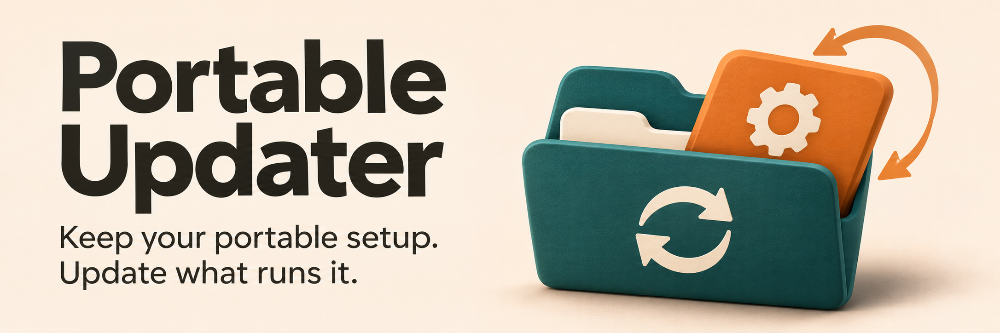
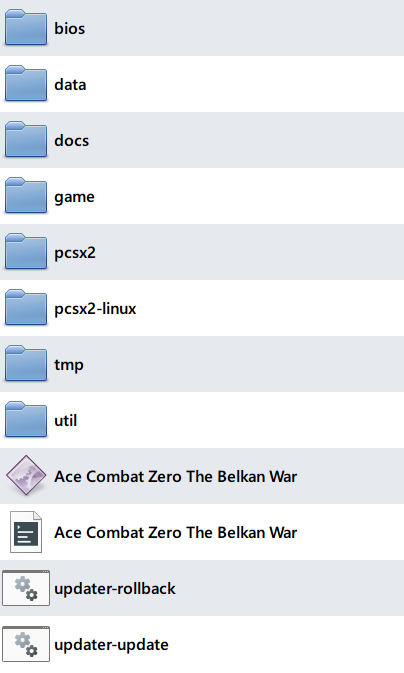
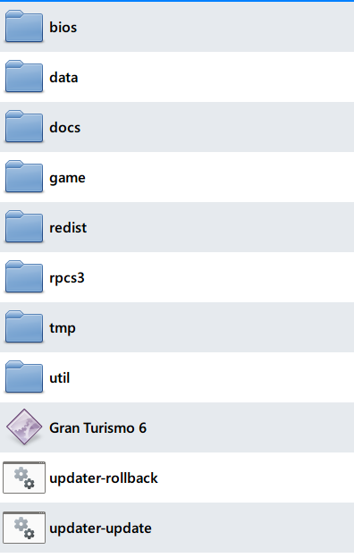

# Portable Updater

Keep the folders and launchers you already use. Update the application inside them, preserve configured settings and saves, and keep the previous runtime available for rollback.

Portable Updater is a Windows x64 tool written in Go for portable applications, emulators and local AI tools. It downloads official packages using reusable application profiles. No installed Go, Python, PowerShell or 7-Zip is needed to run it.

## Get started

1. Download the Windows x64 ZIP from [Releases](https://github.com/keshon/portable-updater/releases) and extract it into a temporary folder.
2. Double-click `portable-update.exe`. Choose your existing application folder and profile, then review its runtime and data paths before confirming.
3. Close the application and double-click the new `updater-update.cmd` in its folder. Keep using your existing application launcher; `updater-rollback.cmd` restores the previous runtime after an update.

Setup checks the existing runtime and portable settings. It does not move application data, overwrite existing updater files or start an update. See [setup and configuration](docs/running.md#set-up-a-container) for the review steps, custom layouts and building from source.

## Console output

The application uses an ordinary console. This is captured output from a disposable DuckStation check:

```text
Portable Updater v0.1.0
Disposable DuckStation updater validation
Checking for updates...
Already current (latest).
```

Update and rollback are run through the container's command files. A console wizard handles first-time setup when `update.json` is absent.

## Included adapters

| Application | Adapter | Container example |
| --- | --- | --- |
| DuckStation | [duckstation-windows.json](adapters/duckstation-windows.json) | [duckstation.json](examples/duckstation.json) |
| KoboldCpp (CUDA) | [koboldcpp-windows.json](adapters/koboldcpp-windows.json) | [koboldcpp.json](examples/koboldcpp.json) |
| PCSX2 | [pcsx2-windows.json](adapters/pcsx2-windows.json) | [pcsx2.json](examples/pcsx2.json) |
| RPCS3 | [rpcs3-windows.json](adapters/rpcs3-windows.json) | [rpcs3.json](examples/rpcs3.json) |
| Cemu | [cemu-windows.json](adapters/cemu-windows.json) | [cemu.json](examples/cemu.json) |
| Xenia | [xenia-windows.json](adapters/xenia-windows.json) | [xenia.json](examples/xenia.json) |
| Dolphin | [dolphin-windows.json](adapters/dolphin-windows.json) | [dolphin.json](examples/dolphin.json) |
| shadPS4 | [shadps4-windows.json](adapters/shadps4-windows.json) | [shadps4.json](examples/shadps4.json) |
| DOSBox Pure Unleashed | [dosbox-pure-windows.json](adapters/dosbox-pure-windows.json) | [dosbox-pure.json](examples/dosbox-pure.json) |

The shadPS4 adapter updates the emulator core in the configured version directory. Its launcher GUI is separate.

## Example game containers

<table>
  <tr>
    <th>PCSX2 — Ace Combat Zero</th>
    <th>RPCS3 — Gran Turismo 6</th>
  </tr>
  <tr>
    <td valign="top"></td>
    <td valign="top"></td>
  </tr>
</table>

These PCSX2 and RPCS3 containers use separate runtime, data and utility directories. See the [operating guide](docs/running.md#storage-and-cleanup) for updater storage and cleanup. Explorer hides file extensions in these screenshots. The PCSX2 folder also includes a Linux runtime; the updater supports Windows only.

## Limits

- Windows x64 only; target applications retain their own OS, hardware and driver requirements.
- Close the application before updating. Verify it works with its data after changing versions; package validation does not establish compatibility.
- Rollback needs its retained previous runtime. External user data keeps its current state.
- Updater self-updates, automatic retention cleanup and a whole-collection update command are not implemented.

## Documentation

- [Running](docs/running.md) - setup, configuration, ordinary use, storage and troubleshooting.
- [Architecture](docs/architecture.md) - components, update flow, state ownership and recovery.
- [Conventions](docs/conventions.md) - development, extension rules and verification.

## License

[MIT](LICENSE), copyright 2026 Innokentiy Sokolov. Dependency license notices are in [THIRD-PARTY-LICENSES.txt](THIRD-PARTY-LICENSES.txt).
